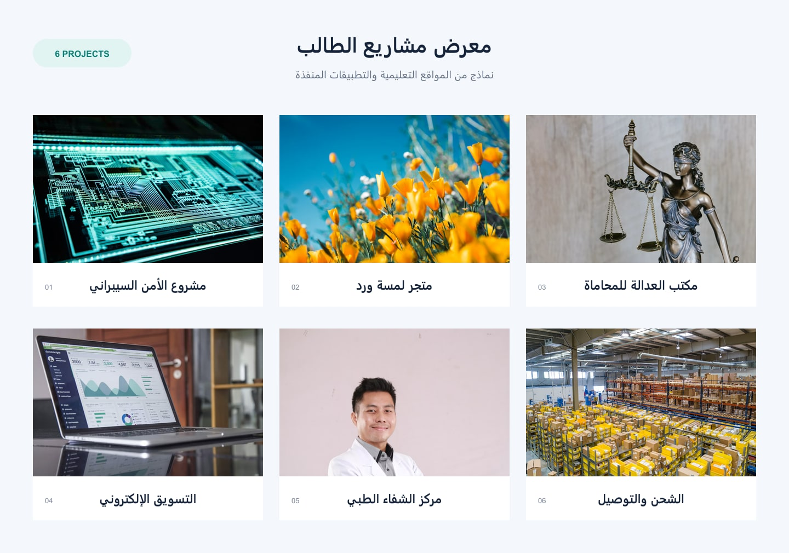

# مشروع الطالب

مجموعة من مواقع الويب التعليمية، ومعرض أعمال، وعرض تقديمي يعرّف بالمشاريع.

## محتويات المستودع

- `index.html`: صفحة البداية، ومنها يمكن الانتقال إلى المشاريع.
- `cybr shield/`: مشروع الأمن السيبراني.
- `اسم «مكتب الميزان للخدمات المحاسبية»/`: مشروع الخدمات المحاسبية.
- `شركة الشحن و التوصيل/`: مشروع الشحن والتوصيل.
- `شركة تسويق الاكتروني/`: مشروع التسويق الإلكتروني.
- `لمسة ورد/`: مشروع متجر الورود.
- `مركز الشفاء الطبي/`: مشروع المركز الطبي.
- `مكتب العدالة للمحاماة والاستشارات القانونية/`: مشروع مكتب المحاماة.
- `معرض الاعمال/`: معرض المشاريع وصفحات التواصل.
- `عرض تقديمي/`: العرض التقديمي للمشاريع.

## تشغيل المشروع

افتح `index.html` في المتصفح، ثم اختر المشروع المطلوب. كل موقع يحتوي ملف `index.html` خاصًا به.

## النشر

ارفع مجلد المستودع كاملًا إلى خدمة الاستضافة الثابتة، مع إبقاء المجلدات والملفات في أماكنها حتى تعمل الروابط والصور المحلية بشكل صحيح.

